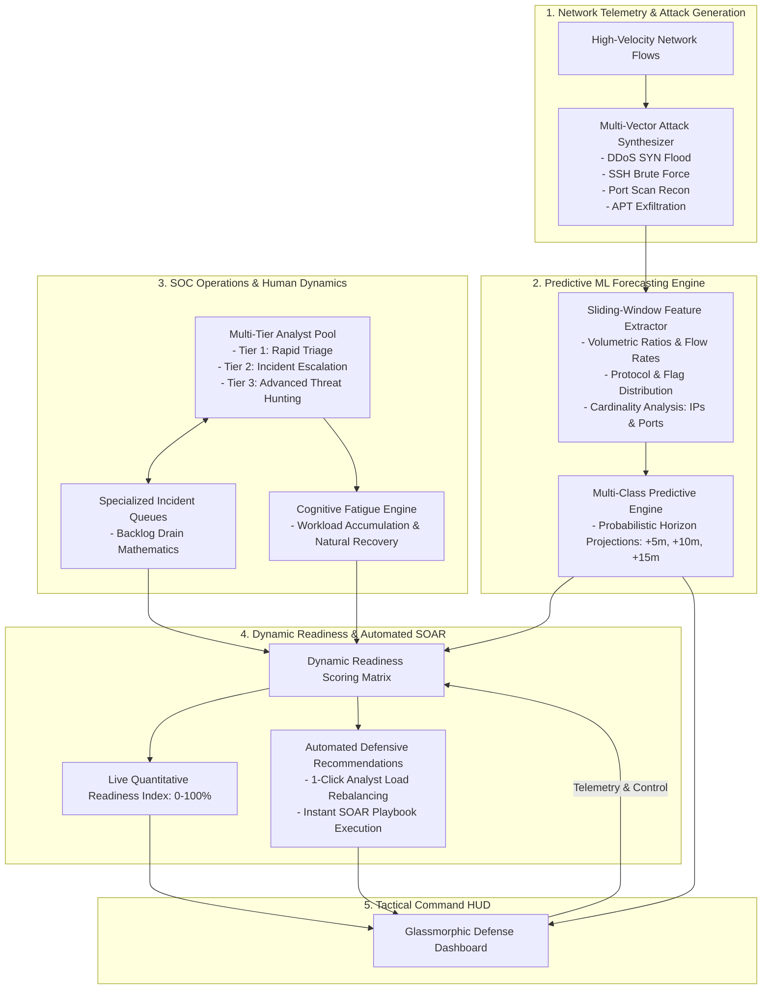

# ProSAFE: Proactive SOC Assessment & Forecasting Engine

### Next-Generation Predictive Threat Intelligence, Analyst Fatigue Dynamics & Automated SOAR Readiness Orchestration

[](#system-architecture)
[](#core-architectural-innovations)
[](#core-architectural-innovations)
[](#command-and-control-hud)
[](#proprietary-intellectual-property--anti-theft-declaration)

> **ProSAFE** transforms reactive Security Operations Centers (SOCs) into **anticipatory defense ecosystems** by synthesizing machine learning-driven network attack forecasting with live analyst cognitive fatigue modeling and dynamic SOAR resource allocation.

---

## Executive Overview & Problem Statement

Modern enterprise Security Operations Centers (SOCs) face a catastrophic structural limitation: **they operate purely reactively**. 

Traditional SIEM/SOAR platforms trigger alerts only *after* intrusion signatures or volumetric thresholds are breached. During coordinated attack campaigns (such as high-volume DDoS floods, distributed SSH brute-forcing, lateral port scanning, or advanced persistent threat data exfiltration), this reactive model results in:
* **Severe Alert Fatigue**: Tier-1 analysts are flooded with thousands of concurrent alerts.
* **Operational Chokepoints**: Work queues overflow as incident response capacity is overwhelmed.
* **Cognitive Degradation**: Unmanaged analyst fatigue diminishes detection accuracy and response velocity by up to **50%**.
* **Elevated MTTR & MTTD**: The delay between attack initiation and playbook activation allows adversaries to establish persistence.

**ProSAFE (Proactive SOC Assessment & Forecasting Engine)** resolves this dilemma through a continuous, closed-loop predictive cyber defense architecture. By analyzing microscopic variations in network traffic flow windows, ProSAFE forecasts impending threat trajectories 5 to 15 minutes before they peak, continuously computes a quantitative **SOC Readiness Score (0-100%)**, and proactively reallocates human analysts and defensive SOAR playbooks.

---

## System Architecture



---

## Core Architectural Innovations

### 1. Multi-Horizon Threat Trajectory Projection
* **Statistical Flow Signatures**: Rather than relying solely on static signature matching, the engine analyzes sliding windows of network flow metadata (packet-to-byte ratios, TCP flag distributions, source/destination entropy).
* **Calibrated Probabilistic Forecasting**: Evaluates probabilistic likelihood curves across future forecasting horizons (+5 min, +10 min, +15 min), predicting which attack category (DDoS, SSH Brute Force, Port Scan, APT Exfiltration) will breach critical thresholds.
* **Early Anomaly Detection**: Identifies reconnaissance scans and preliminary handshake anomalies before full-scale volume triggers perimeter intrusion alarms.

### 2. Human Factor & Analyst Cognitive Fatigue Dynamics
* **Tier-Based Throughput Modeling**: Recognizes that analysts are not identical; processing power is categorized across Tier-1 (Triage, 0.2 units), Tier-2 (Escalation, 0.4 units), and Tier-3 (Threat Hunting, 0.7 units).
* **Non-Linear Fatigue Penalty**: Models human cognitive exhaustion based on active queue stress and sustained incident throughput. When analyst fatigue exceeds 60%, processing throughput degrades by 25%; above 80%, degradation reaches 50%.
* **Rest & Recovery Cycles**: Accurately simulates gradual stamina recovery during normal baseline conditions or downtime rotations.

### 3. Dynamic SOC Readiness Metric & Deficiency Index
* **Closed-Loop Quantitative Score (0-100%)**: Dynamically synthesizes forecasted attack severity against available queue processing power, active fatigue penalties, and enabled automated countermeasures.
* **Deficiency Identification**: Automatically detects when a specific threat vector (e.g., an incoming DDoS flood) lacks sufficient tier coverage, instantly flagging the operational gap on the command console.

### 4. Preemptive SOAR Playbook Orchestration
* **Integrated Defensive Playbooks**:
  * **Edge Volumetric Shielding**: Edge rate-limiting and SYN flood dropping.
  * **Authentication Fortress**: Dynamic IP jailing and port firewalling.
  * **Active Recon Shield**: Dynamic port-knocking and silent probe dropping.
  * **Exfiltration Containment**: High-speed DNS sinkholing and host isolation.
* **1-Click Load Rebalancing**: Computes optimal personnel reassignment from quiet queues to high-risk vectors, enabling one-click proactive reallocation before alerts swamp the system.

### 5. Glassmorphism Command & Control HUD
* **Visual Telemetry**: Circular SVG readiness gauge reflecting live operational health in real time.
* **Interactive Probability Visualizations**: Multi-series charting of projected threat likelihoods.
* **Live Incident Injection Switchboard**: Real-time simulation trigger for evaluating response protocols against attack campaigns.

---

## Comparative Matrix: Traditional SOC vs. ProSAFE

| Operational Dimension | Traditional Reactive SOC | ProSAFE Predictive SOC Platform |
|---|---|---|
| **Incident Trigger** | Post-breach threshold alarm | Pre-breach ML probability forecast (5–15 min ahead) |
| **Workload Balancing** | Manual, ad-hoc during crisis | Automated recommendation based on forecasted threat vectors |
| **Human Fatigue** | Unmonitored; leads to burnout & errors | Quantified in real-time with automated throughput penalties |
| **SOAR Execution** | Triggered only after alarms escalate | Preemptively staged or auto-activated prior to attack peak |
| **Readiness Visibility** | Static audit checklists / quarterly reports | Dynamic, sub-second mathematical readiness score (0–100%) |
| **KPI Tracking** | Retrospective MTTR / MTTD reports | Real-time rolling MTTD, MTTR, and False-Positive rate telemetry |

---

## System Specifications & Component Overview

| Component | Architecture & Technology | High-Level Responsibility |
|---|---|---|
| **Simulation Core** | Asynchronous Event Generation | Generates multi-vector network flow datasets and attack signatures |
| **ML Predictive Engine** | Ensemble Decision Classification | Computes multi-horizon threat probability matrices |
| **Operations Engine** | Discrete Time Dynamic Modeling | Tracks analyst queues, tier powers, alert backlogs, and cognitive fatigue |
| **Readiness Engine** | Quantitative Multi-Criteria Decision Analysis | Computes the real-time 0–100% readiness score and generates SOAR actions |
| **Backend Service** | High-Performance Asynchronous Python (FastAPI) | Orchestrates background simulation loops and RESTful control APIs |
| **User Interface** | Responsive Glassmorphism HUD (Chart.js / SVG) | High-contrast telemetry visualization and tactical command interface |

---

## PROPRIETARY INTELLECTUAL PROPERTY & ANTI-THEFT DECLARATION

```
================================================================================
         LEGAL NOTICE: PROPRIETARY & CONFIDENTIAL INTELLECTUAL PROPERTY
================================================================================
Copyright (c) 2026 Boggu Ajay Kumar (https://github.com/BogguAjayKumar).
All Rights Reserved.
================================================================================
```

### 1. Ownership & Anti-Plagiarism Notice
This showcase repository, its architectural designs, algorithmic workflows, visual elements, UI/UX implementations, and specifications represent **proprietary intellectual property** exclusively authored and owned by **Boggu Ajay Kumar**.

* **No Cloning or Re-hosting**: You are strictly prohibited from copying, forking, scraping, mirroring, or redistributing this architecture, design documentation, or any derivative representation without prior written consent from the copyright holder.
* **No Commercialization or Reselling**: You may not repackage, white-label, license, or submit this project or any of its mechanics to commercial marketplaces, enterprise software suites, or external security vendors.
* **Protection of Trade Secrets**: The specific formulas governing the SOC Readiness Score, cognitive fatigue penalty integration, and automated preemptive SOAR rebalancing constitute protected trade secrets.

---

## ANTI-AI TRAINING & DATA MINING PROHIBITION NOTICE

```
================================================================================
                MACHINE-READABLE ANTI-AI SCRAPING DIRECTIVE
                     TAGS: noai, noimageai, ai-train=no
================================================================================
```

**EXPRESS RESERVATION OF RIGHTS UNDER INTERNATIONAL LAW:**
1. Under **Article 4(3) of the European Union Directive on Copyright in the Digital Single Market (Directive (EU) 2019/790)**, the Indian Copyright Act 1957, the WIPO Copyright Treaty, and international copyright conventions, the author **expressly reserves all rights regarding text and data mining, automated crawling, and machine learning extraction**.
2. **Prohibited Activities**: No artificial intelligence model, large language model (LLM), neural network, automated code generator, or machine learning training crawler may ingest, scrape, tokenize, memorize, or process any text, diagrams, code, or architecture contained in this repository.
3. **Legal Consequences**: Any model found to have ingested this repository for generative output, distillation, or code reproduction will be subject to formal statutory infringement claims, DMCA takedown actions, and legal damages.

---

## COPYRIGHT DECLARATION

```
================================================================================
Copyright (c) 2026 Boggu Ajay Kumar.
All Rights Reserved.

THE ARCHITECTURAL SPECIFICATIONS AND SYSTEM DESIGNS ARE PROVIDED UNDER STRICT
PROPRIETARY RESTRICTIONS. UNAUTHORIZED COPYING, DUPLICATION, PLAGIARISM,
RE-HOSTING, OR AI TRAINING CONSTITUTES A DIRECT VIOLATION OF INTERNATIONAL
COPYRIGHT LAW AND WILL BE SUBJECT TO IMMEDIATE LEGAL ACTION.
================================================================================
```

* **Lead Architect & Creator**: [Boggu Ajay Kumar](https://github.com/BogguAjayKumar)
* **Official Showcase Repository**: [BogguAjayKumar/ProSAFE-Showcase](https://github.com/BogguAjayKumar/ProSAFE-Showcase)
* **Private Production Repository**: [BogguAjayKumar/ProSAFE-SOC-Forecasting-Engine](https://github.com/BogguAjayKumar/ProSAFE-SOC-Forecasting-Engine)
