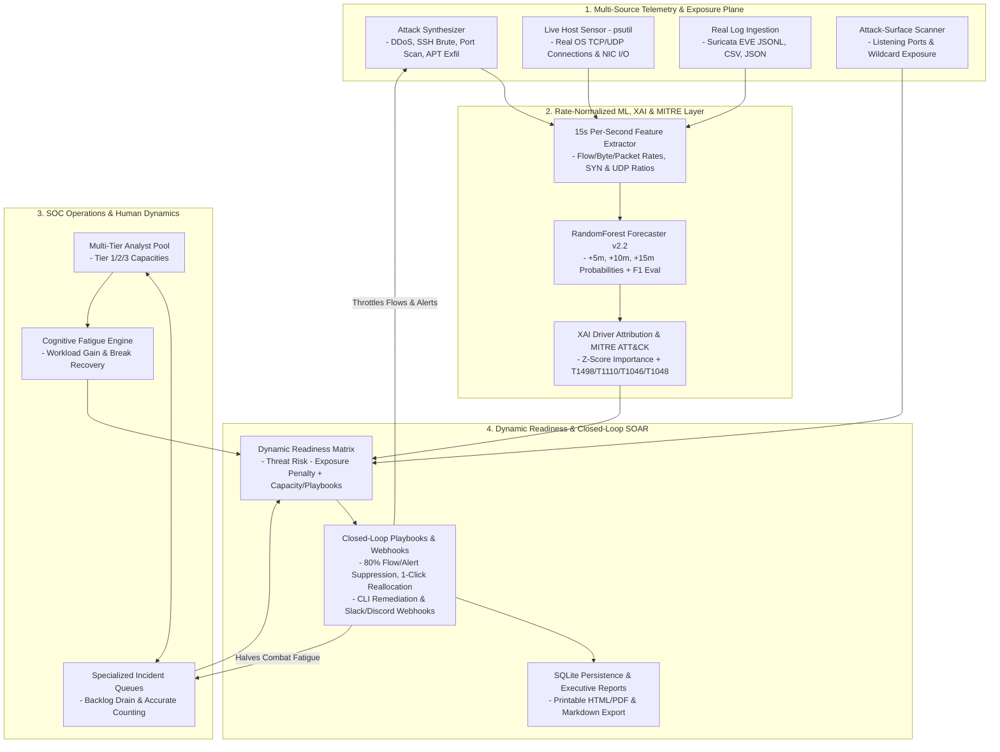

# ProSAFE: Proactive SOC Assessment & Forecasting Engine

### Next-Generation Predictive Threat Intelligence (XAI + MITRE ATT&CK), Live Host Posture Scanning, Analyst Fatigue Dynamics & Closed-Loop SOAR Orchestration

[](#system-architecture)
[](#core-architectural-innovations)
[](#core-architectural-innovations)
[](#core-architectural-innovations)
[](#core-architectural-innovations)
[](#proprietary-intellectual-property--anti-theft-declaration)

> **ProSAFE** transforms reactive Security Operations Centers (SOCs) into **anticipatory defense ecosystems** by uniting rate-normalized ML threat forecasting (with Explainable AI drivers and MITRE ATT&CK mapping), real-time host socket & attack-surface posture scanning, Suricata/CSV log ingestion, analyst cognitive fatigue modeling, and closed-loop SOAR playbooks.

---

## Executive Overview & Problem Statement

Modern enterprise Security Operations Centers (SOCs) face a catastrophic structural limitation: **they operate purely reactively**. 

Traditional SIEM/SOAR platforms trigger alerts only *after* intrusion signatures or volumetric thresholds are breached. During coordinated attack campaigns (such as high-volume DDoS floods, distributed SSH brute-forcing, lateral port scanning, or advanced persistent threat data exfiltration), this reactive model results in:
* **Severe Alert Fatigue**: Tier-1 analysts are flooded with thousands of concurrent alerts.
* **Operational Chokepoints**: Work queues overflow as incident response capacity is overwhelmed.
* **Cognitive Degradation**: Unmanaged analyst fatigue diminishes detection accuracy and response velocity by up to **50%**.
* **Elevated MTTR & MTTD**: The delay between attack initiation and playbook activation allows adversaries to establish persistence.

**ProSAFE (Proactive SOC Assessment & Forecasting Engine)** resolves this dilemma through a continuous, closed-loop predictive cyber defense architecture. By analyzing microscopic variations in network traffic flow windows, ProSAFE forecasts impending threat trajectories 5 to 15 minutes before they peak, continuously computes a quantitative **SOC Readiness Score (0-100%)**, and proactively reallocates human analysts and defensive SOAR playbooks.

---

## System Architecture



---

## Core Architectural Innovations

### 1. Rate-Normalized Threat Forecasting & Explainable AI (XAI)
* **Scale-Invariant Per-Second Telemetry**: Normalizes sliding 15-second windows into per-second rates (`flows_per_sec`, `bytes_per_sec`, `packets_per_sec`, `unique_src_ips_per_sec`, `unique_dst_ports_per_sec`) alongside `syn_ratio`, `udp_ratio`, `avg_bytes_per_flow`, and `avg_packets_per_flow` so short bursts and full windows evaluate consistently.
* **Calibrated +5m / +10m / +15m Horizon Projections**: Evaluates damped multi-step threat probability curves across DDoS, SSH Brute Force, Port Scan, and APT Exfiltration with persisted `RandomForestClassifier` validation metrics (accuracy and macro-F1).
* **Feature-Level Attribution (XAI)**: Computes z-score deviations weighted by Random Forest feature importances to tell analysts *why* a threat spiked (e.g., elevated SYN ratio or unique source IP velocity).

### 2. Multi-Source Telemetry & Proactive Attack-Surface Posture Scanner
* **Live Host Sensor (`psutil`)**: Samples real active OS TCP/UDP connections and network interface byte/packet deltas directly from the host into ProSAFE's flow pipeline (`LIVE HOST SENSOR` mode).
* **Suricata EVE & CSV Log Ingestion**: Parses uploaded or replayed Suricata EVE JSONL, generic JSON, and CSV/CIC-IDS flow captures and re-anchors timestamps into the live forecasting window.
* **Proactive Port Exposure Scoring**: Scans listening host sockets (`0.0.0.0` / `::` wildcard bindings vs. loopback), flags risky exposed services (`21`, `22`, `23`, `25`, `135`, `139`, `445`, `1433`, `3306`, `3389`, `5432`, `6379`, `8000`, `8080`, `27017`) with process names and hardening guidance, and applies a `0–18 pt` Readiness Exposure Penalty *before* an attack begins.

### 3. Human Factor & Analyst Cognitive Fatigue Dynamics
* **Tier-Based Throughput Modeling**: Categorizes processing power across Tier-1 (Triage, `0.2`), Tier-2 (Escalation, `0.4`), and Tier-3 (Threat Hunting, `0.7`) with accurate fractional incident accounting.
* **Non-Linear Fatigue Penalty**: When analyst fatigue exceeds `60%`, throughput drops by `25%`; above `80%`, degradation reaches `50%`. Rotating fatigued analysts to `Idle / Break` accelerates recovery.

### 4. Closed-Loop SOAR Playbooks, MITRE ATT&CK & Executive Reporting
* **Active Flow & Queue Suppression**: Enabling a playbook (`Cloudflare Edge Rate Limiting`, `Fail2Ban & Port 22 Firewalling`, `Dynamic Port Knocking & Dropping`, `DNS Sinkholing & Host Quarantine`) actively drops **80% of matching attack flows** in the telemetry loop, suppresses alert queue ingestion by **80%**, and halves combat fatigue accumulation.
* **MITRE ATT&CK Enrichment**: Maps active threats to `T1498.001`, `T1110.001`, `T1046`, and `T1048.003` with tactic, kill-chain stage, and defensive controls.
* **Actionable Ops & Persistence**: Generates copy-ready CLI mitigation commands (`iptables`, `fail2ban-client`, `nft`, `unbound-control`), dispatches Slack/Discord/JSON webhooks, maintains an **SOAR Audit Timeline** backed by **SQLite**, and exports printable **HTML/PDF** and **Markdown** Executive Incident Reports.

### 5. Offline-Ready Glassmorphism Command & Control HUD
* **Zero-CDN Demo Resilience**: Bundles `Chart.js` and `Lucide` locally so dashboard charts and icons work in air-gapped or offline hackathon venues.
* **Non-Destructive Live Polling**: Updates analyst `<select>` dropdowns and playbook switches in-place every 2 seconds without disrupting active operator interactions.

---

## Comparative Matrix: Traditional SOC vs. ProSAFE

| Operational Dimension | Traditional Reactive SOC | ProSAFE Predictive SOC Platform |
|---|---|---|
| **Incident Trigger** | Post-breach threshold alarm | Pre-breach ML probability forecast (+5/10/15 min) + XAI drivers |
| **Telemetry Sources** | Single proprietary SIEM agent | Hybrid Simulator, Live Host Sensor (`psutil`), & Suricata EVE / CSV |
| **Proactive Posture** | Separate periodic vulnerability scans | Live listening-port exposure scan baked into Readiness Score |
| **Workload Balancing** | Manual, ad-hoc during crisis | Automated 1-click analyst reallocation by tier & fatigue |
| **SOAR Execution** | Post-escalation manual tickets | Closed-loop 80% flow/queue suppression + CLI commands + Webhooks |
| **Compliance & Reporting** | Manual post-incident writeups | Automated MITRE ATT&CK mapping + 1-click HTML/PDF & `.MD` reports |

---

## System Specifications & Component Overview

| Component | Architecture & Technology | High-Level Responsibility |
|---|---|---|
| **Telemetry & Ingestion Core** | Python Async Loop + Suricata/CSV Parser | Generates attack profiles, ingests EVE/CSV logs, and applies 80% playbook suppression |
| **Live Host Sensor** | Cross-Platform OS Introspection (`psutil`) | Streams live host TCP/UDP connections and scans listening port exposure |
| **ML & XAI Engine** | Rate-Normalized `RandomForestClassifier` (`joblib`) | Computes +5/10/15m threat probabilities, F1 metrics, and feature attribution |
| **Operations & Persistence** | Discrete Time Queue/Fatigue Model + `sqlite3` | Tracks analyst queues, cognitive fatigue, KPIs, and persistent audit timeline |
| **Readiness, MITRE & Reporting** | Multi-Criteria Readiness Engine + `httpx` | Computes `0–100%` readiness, MITRE ATT&CK mapping, webhooks, and PDF/MD reports |
| **Backend & Command HUD** | FastAPI + Offline Bundled Chart.js / SVG | Serves REST APIs and an offline-capable glassmorphism SOC dashboard |

---

## PROPRIETARY INTELLECTUAL PROPERTY & ANTI-THEFT DECLARATION

```
================================================================================
         LEGAL NOTICE: PROPRIETARY & CONFIDENTIAL INTELLECTUAL PROPERTY
================================================================================
Copyright (c) 2026 Boggu Ajay Kumar (https://github.com/BogguAjayKumar).
All Rights Reserved.
================================================================================
```

### 1. Ownership & Anti-Plagiarism Notice
This showcase repository, its architectural designs, algorithmic workflows, visual elements, UI/UX implementations, and specifications represent **proprietary intellectual property** exclusively authored and owned by **Boggu Ajay Kumar**.

* **No Cloning or Re-hosting**: You are strictly prohibited from copying, forking, scraping, mirroring, or redistributing this architecture, design documentation, or any derivative representation without prior written consent from the copyright holder.
* **No Commercialization or Reselling**: You may not repackage, white-label, license, or submit this project or any of its mechanics to commercial marketplaces, enterprise software suites, or external security vendors.
* **Protection of Trade Secrets**: The specific formulas governing the SOC Readiness Score, cognitive fatigue penalty integration, and automated preemptive SOAR rebalancing constitute protected trade secrets.

---

## ANTI-AI TRAINING & DATA MINING PROHIBITION NOTICE

```
================================================================================
                MACHINE-READABLE ANTI-AI SCRAPING DIRECTIVE
                     TAGS: noai, noimageai, ai-train=no
================================================================================
```

**EXPRESS RESERVATION OF RIGHTS UNDER INTERNATIONAL LAW:**
1. Under **Article 4(3) of the European Union Directive on Copyright in the Digital Single Market (Directive (EU) 2019/790)**, the Indian Copyright Act 1957, the WIPO Copyright Treaty, and international copyright conventions, the author **expressly reserves all rights regarding text and data mining, automated crawling, and machine learning extraction**.
2. **Prohibited Activities**: No artificial intelligence model, large language model (LLM), neural network, automated code generator, or machine learning training crawler may ingest, scrape, tokenize, memorize, or process any text, diagrams, code, or architecture contained in this repository.
3. **Legal Consequences**: Any model found to have ingested this repository for generative output, distillation, or code reproduction will be subject to formal statutory infringement claims, DMCA takedown actions, and legal damages.

---

## COPYRIGHT DECLARATION

```
================================================================================
Copyright (c) 2026 Boggu Ajay Kumar.
All Rights Reserved.

THE ARCHITECTURAL SPECIFICATIONS AND SYSTEM DESIGNS ARE PROVIDED UNDER STRICT
PROPRIETARY RESTRICTIONS. UNAUTHORIZED COPYING, DUPLICATION, PLAGIARISM,
RE-HOSTING, OR AI TRAINING CONSTITUTES A DIRECT VIOLATION OF INTERNATIONAL
COPYRIGHT LAW AND WILL BE SUBJECT TO IMMEDIATE LEGAL ACTION.
================================================================================
```

* **Lead Architect & Creator**: [Boggu Ajay Kumar](https://github.com/BogguAjayKumar)
* **Official Showcase Repository**: [BogguAjayKumar/ProSAFE-Showcase](https://github.com/BogguAjayKumar/ProSAFE-Showcase)
* **Private Production Repository**: [BogguAjayKumar/ProSAFE-SOC-Forecasting-Engine](https://github.com/BogguAjayKumar/ProSAFE-SOC-Forecasting-Engine)
